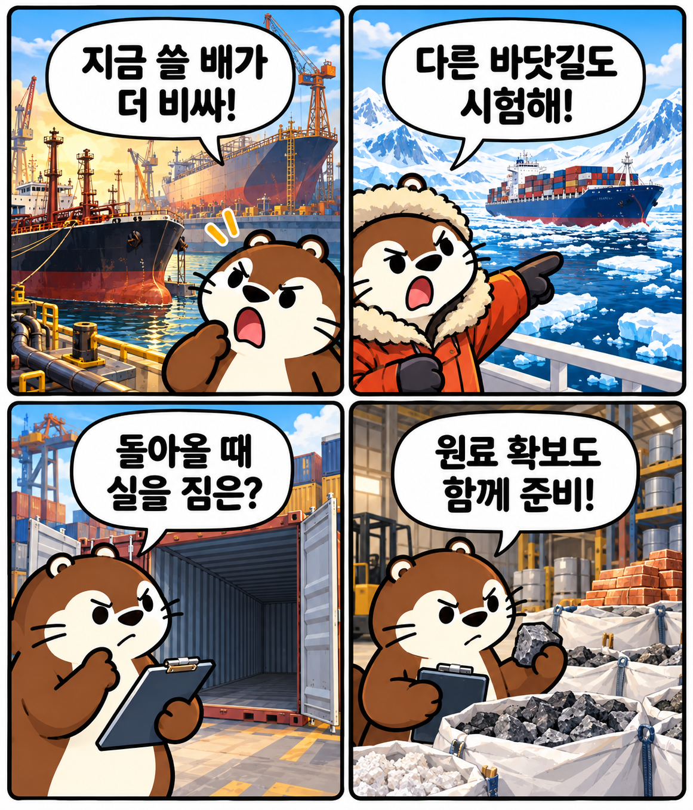
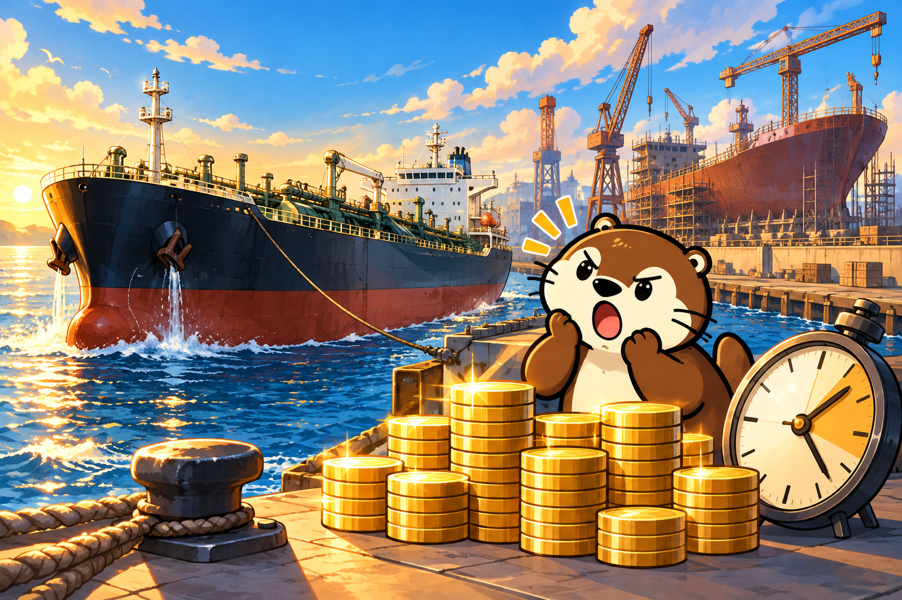
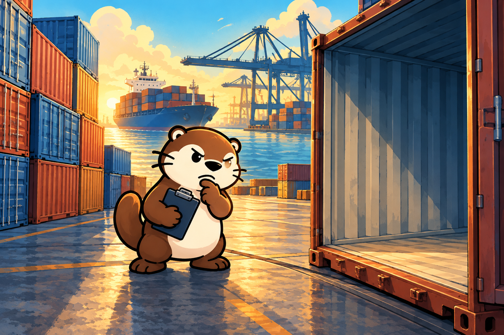
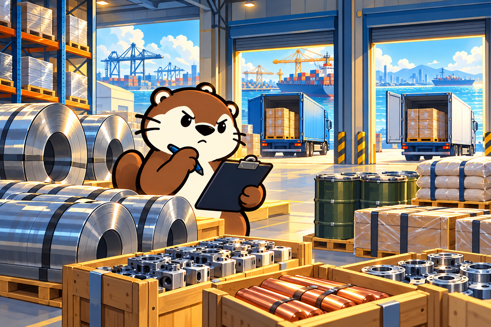

# 오늘의 경제 흐름

2026년 10월 13일 화요일 · 읽는 시간 약 4분

# 10년 된 배가 새 배보다 비싸진 이유는?

중고 유조선의 몸값에서 북극항로와 원료 확보까지, 네 가지 뉴스로 읽는 물류의 흐름

## 오늘의 핵심

- 운임이 오르고 새 배를 받기까지 오래 걸리자, 바로 투입할 수 있는 중고 유조선이 새 배보다 비싸졌어요.
- 북극항로 시범운항은 새로운 운송 경로의 가능성을 보여줬어요. 다만 돌아오는 길의 화물 확보 등 상업화 과제도 남았어요.
- 정부는 핵심 원료와 부품의 공급망 관리도 강화하기로 했어요. 물건을 제때 가져오려면 배와 항로, 공급처를 함께 준비해야 해요.

## 1. 10년 된 중고 유조선이 새 배보다 비싸졌어요

보통 오래 쓴 물건은 새것보다 싸요. 그런데 바다에서는 반대 일이 벌어졌어요. 10월 12일 nbn시사경제는 한국해양진흥공사 자료를 인용해, 10년 된 초대형 원유운반선 가격이 새로 만드는 배보다 높아졌다고 전했어요.

보도된 중고선 가격은 1억 5,223만 달러, 새 배 가격은 1억 2,946만 달러였어요. 중고선이 약 17.6% 더 비싼 셈이에요. 모든 종류의 배가 아니라, 초대형 원유운반선이라는 특정 선종의 가격 비교예요.

배경에는 중동 분쟁에 따른 해상 운송 차질과 운임 상승이 있어요. 항로를 우회하거나 운항 시간이 길어지면 같은 배로 실어 나를 수 있는 물량이 줄고, 배를 확보하려는 경쟁이 커질 수 있어요.

새 배를 주문해도 받기까지 수년이 걸려요. 반면 운항 가능한 중고선은 바로 투입해 운임 수입을 얻을 수 있죠. **배의 나이보다 지금 쓸 수 있다는 점에 더 큰 값이 붙은 거예요.**

이 비용은 해운회사만의 문제가 아니에요. 운송비가 높아지면 원료를 들여오는 기업의 부담도 커지고, 일부는 제품 가격에 반영될 수 있어요. 그러면 배를 구하는 것과 함께, 물건이 오가는 길도 다시 살펴보게 돼요.

> **운임이란?** 배나 비행기, 트럭으로 물건을 옮기는 대가예요. 운송 수요와 이용할 수 있는 운송수단, 연료비와 항로 여건 등에 따라 달라져요.

출처: [nbn시사경제 · 10년 된 중고 유조선, 사상 첫 신조선가 추월…물류대란 여파](https://www.nbnbiz.co.kr/news/articleView.html?idxno=46278) · 2026.10.12

## 2. 한국 컨테이너선은 새로운 바닷길을 시험했어요

운송을 안정적으로 이어가려면 배뿐 아니라 항로의 선택지도 중요해요. 이런 관점에서 함께 볼 뉴스가 북극항로 시범운항이에요. 10월 12일 KNN은 팬스타 아크로호가 북극항로를 거쳐 유럽을 다녀온 뒤, 11일 부산항으로 돌아왔다고 전했어요.

국내 컨테이너선이 북극해를 통과해 유럽까지 왕복한 첫 사례예요. 이번 운항은 기존 수에즈운하 경유 항로와 비교해 거리와 시간, 연료비를 줄일 수 있는지 확인하는 시험이었어요.

여기서 앞의 뉴스와 배 종류를 구분해야 해요. 유조선은 원유를, 컨테이너선은 컨테이너에 담은 화물을 운반해요. 이번 시험이 중동의 원유 운송 문제를 바로 해결했다는 뜻은 아니에요. **서로 다른 뉴스가 운송 경로를 확보하는 문제로 연결되는 거예요.**

운항 시간이 줄면 연료와 선박을 사용하는 시간을 아낄 여지가 생겨요. 화물을 보내는 기업도 물건을 더 빨리 받을 수 있고요. 다만 얼음과 기상, 안전 조건에 따라 실제 운항 여건은 달라져요.

KNN은 이번 항해에서 얻은 데이터를 바탕으로 상업 운항이 가능한지 검증하는 일이 관건이라고 짚었어요. 갈 수 있는 길을 확인했다면, 다음에는 그 길로 꾸준히 수익을 낼 수 있는지 봐야 해요.

> **시범운항이란?** 새 항로나 운항 방식을 실제로 시험해 시간·비용·안전 등의 자료를 얻는 과정이에요. 정기적인 상업 운항이 시작됐다는 뜻은 아니에요.

출처: [KNN · [경제브리핑]-팬스타귀항, 기업현안건의](https://news.knn.co.kr/news/article/193055) · 2026.10.12

## 3. 길은 짧아졌지만, 돌아올 때 실을 짐이 없었어요

같은 날 프레시안의 후속 보도는 북극항로의 성과와 숙제를 함께 보여줬어요. 부산에서 네덜란드 로테르담까지 약 22일이 걸려, 기존 수에즈운하 경유 항로보다 열흘 안팎을 단축했다고 전했어요. 왕복 전체가 아니라 이 편도 구간을 비교한 수치예요.

그런데 돌아오는 길에는 수입 화물을 확보하지 못해 공컨테이너를 싣고 왔다고 해요. 갈 때 수출 화물을 운반했어도, 돌아올 때 운임을 받을 화물이 부족하면 왕복 운항의 수익성이 낮아질 수 있어요.

배는 화물이 적다고 연료와 인건비가 사라지지 않아요. **거리를 줄여 비용을 아끼는 것과, 실을 짐을 확보해 매출을 만드는 것은 함께 풀어야 할 문제예요.**

물론 한 번의 시범운항 결과만으로 북극항로 전체가 적자라고 단정할 수는 없어요. 앞으로 확보할 물량과 운항 횟수, 계절별 비용을 따져봐야 해요. 이번 보도는 짧은 항로의 가능성과 지속적인 사업의 조건이 다르다는 점을 보여줘요.

배와 길을 준비해도 옮길 물건을 제때 확보하지 못하면 운송은 이어지기 어려워요. 시선을 조금 넓히면, 한국의 공장에 필요한 원료와 부품도 어디서 어떻게 가져올지 함께 준비해야 해요.

> **공컨테이너란?** 화물이 들어 있지 않은 컨테이너예요. 필요한 곳으로 다시 옮겨야 하지만, 운임을 받는 화물을 실은 경우와는 수익 구조가 달라요.

출처: [프레시안 · 북극항로 '10일 단축' 확인했지만, 부산 기업 200곳 중 실제 대응 2곳](https://www.pressian.com/pages/articles/2026101211065355022) · 2026.10.12

## 4. 정부는 핵심 원료와 부품의 공급망도 보강하기로 했어요

운송 경로와 함께 물건의 공급처를 준비하는 움직임도 나왔어요. 뉴시스는 정부가 10월 12일 공급망안정화위원회를 열고, 경제안보품목을 기존 327개에서 340개로 확대하는 방안을 발표했다고 전했어요.

반도체·재생에너지·우주항공 등 첨단산업의 핵심품목 13개를 추가하고, 수출통제 등에 미리 대응해야 할 100개 안팎의 품목을 집중 관리한다는 계획이에요. 중점관리품목에는 공급망안정화기금 대출금리를 최대 2.3%포인트 우대하는 지원도 추진해요.

기금은 전략물자 비축과 수입선 다변화를 지원하는 프로그램도 신설하기로 했어요. 미리 재고를 확보하고, 특정 나라나 업체에만 의존하지 않도록 물건을 구할 곳을 넓히는 거예요. 원유와 나프타의 수급도 계속 점검한다고 밝혔어요.

북극항로 뉴스가 보여준 것은 운송 경로의 선택지예요. 정부의 이번 방안은 공급처와 재고를 보강하는 준비이고요. 물건이 지나올 길과 필요한 물건 자체를 함께 확보해야 생산과 배송을 안정적으로 이어갈 수 있어요.

**오늘의 네 가지 뉴스는 물건을 제때 가져오는 능력에도 비용과 준비가 필요하다는 이야기로 이어져요.** 당장 쓸 배를 구하고, 다른 길을 시험하고, 왕복 화물을 확보하고, 원료 공급처를 보강하는 일이죠.

앞으로는 유조선 운임이 안정되는지, 북극항로에서 정기적으로 실을 화물이 확보되는지, 발표된 비축·수입선 지원이 실제로 실행되는지를 함께 살펴봐요. 그 변화가 기업의 운송비와 생산비 부담을 줄이는지 확인할 수 있어요. **물건값에는 만드는 비용뿐 아니라, 제때 가져오는 비용도 들어 있어요.**

> **공급망이란?** 원료와 부품을 구하고 제품을 만들어 운송·판매하기까지 연결된 과정이에요. 한 단계에 차질이 생겨도 뒤의 생산과 배송이 영향을 받을 수 있어요.

출처: [뉴시스 · 경제안보품목 340개로 확대…핵심 100개 금리 최대 2.3%p 우대](https://www.newsis.com/view/NISX20261012_0003821671) · 2026.10.12

## 오늘의 한 문장

**물건값에는 만드는 비용뿐 아니라, 제때 가져오는 비용도 들어 있어요.**
